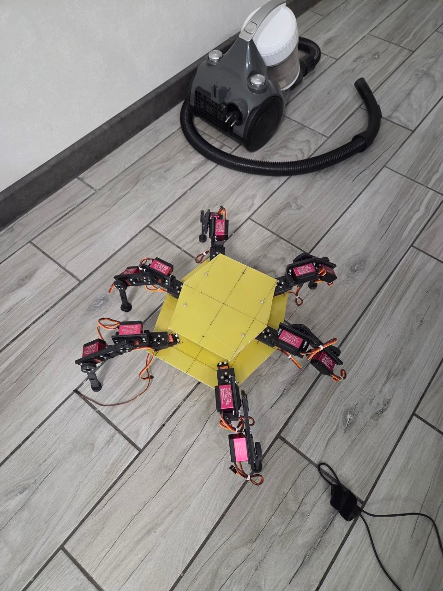
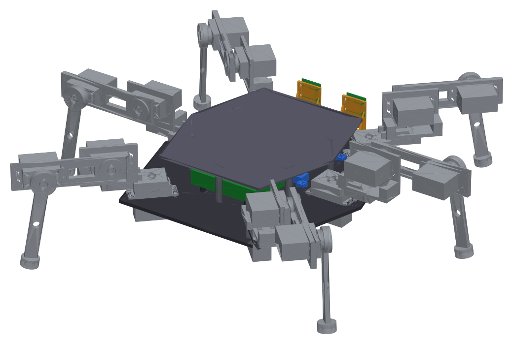
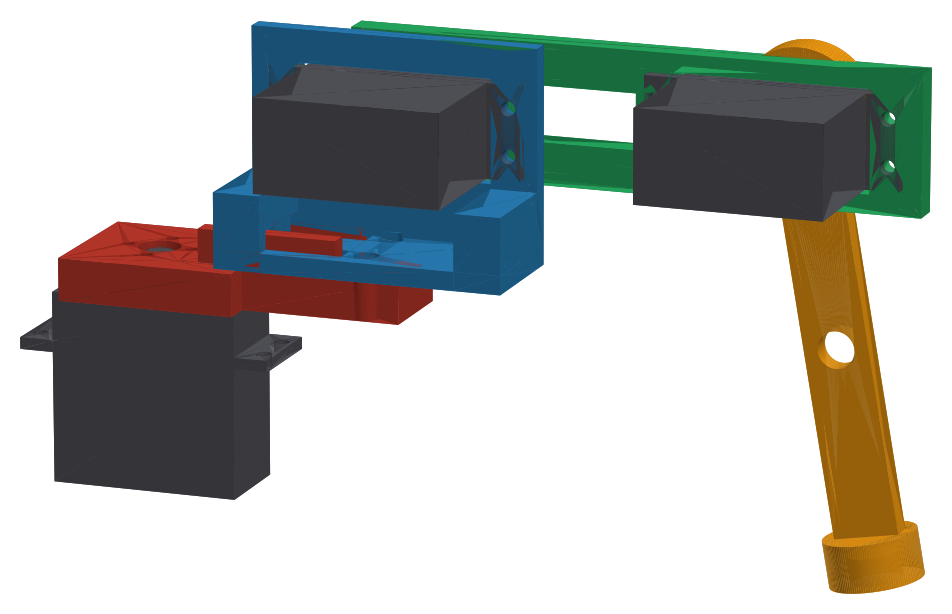
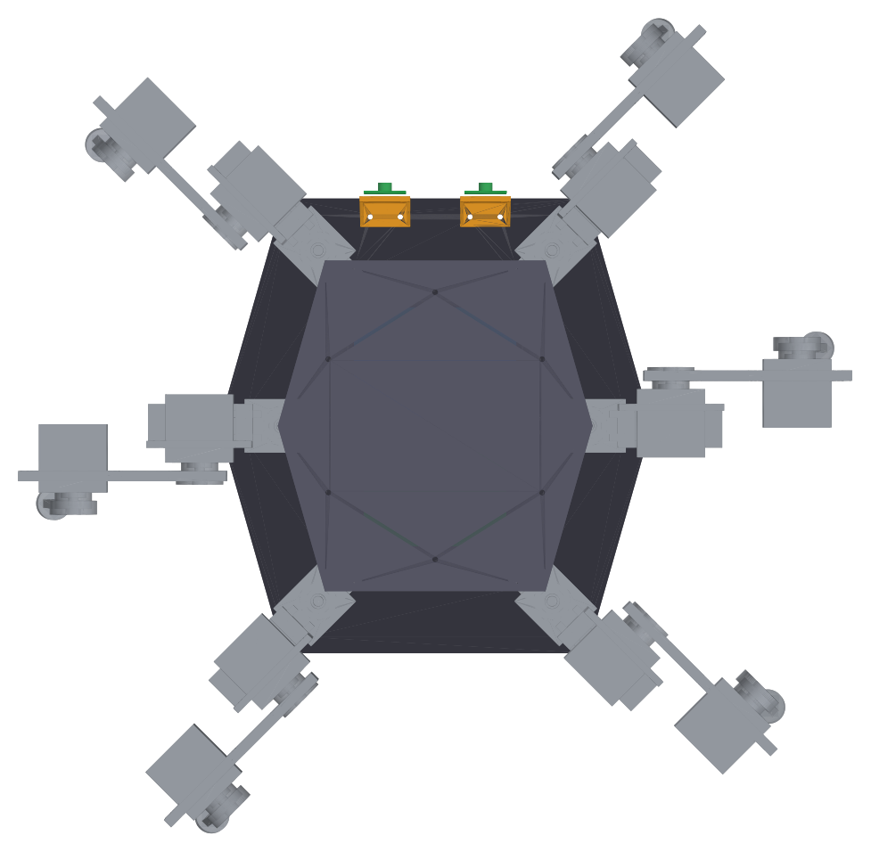

# Hexapod — 6-legged robot (FreeCAD macros, printable parts, stereo vision)

| The real robot | The model |
|---|---|
|  |  |

A ~30 cm six-legged walking robot (hexapod) with 3 joints per leg (18 servos).
The whole mechanical design is **code**: every part is a parametric FreeCAD
macro, so dimensions can be changed in one place and the STL files rebuilt.

**Status: work in progress.** The mechanics and the vision code exist; walking
does not yet. See [Status](#status) for exactly what is done and what is not.

> **Note:** all code in this repository — the FreeCAD macros, the build scripts and
> the vision pipeline — is a first draft. It will be reworked and refined as the
> robot is built and tested, so expect dimensions, interfaces and file layout to change.

Author: Evgenii Zagorodskikh.

---

## Contents

1. [What is in this repository](#what-is-in-this-repository)
2. [System architecture](#system-architecture)
3. [Status](#status)
4. [Mechanics](#mechanics)
5. [Printing](#printing)
6. [Bill of materials](#bill-of-materials)
7. [Rebuilding the models](#rebuilding-the-models)
8. [Vision](#vision)
9. [Design notes and known issues](#design-notes-and-known-issues)
10. [License](#license)

---

## What is in this repository

| Path | What it is |
|---|---|
| `cad/leg/` | One leg: one FreeCAD macro per part, plus the assembly macro |
| `cad/leg/SpiderLeg.FCStd` | The assembled leg (built from the macros) |
| `cad/body/Hexapod.FCMacro` | Full robot: 6 legs, two decks, board mounts, camera brackets |
| `cad/body/Hexapod.FCStd` | The assembled robot (built from the macros) |
| `cad/build_all.py` | Rebuilds every model, STL and STEP file headless and checks them |
| `cad/tools/` | Preview renders and dimension drawings |
| `stl/` | Print-ready STL files, already laid flat for printing |
| `step/` | STEP files of every part and of both assemblies |
| `docs/drawings/` | Top-view dimension drawings of the decks and the camera bracket |
| `docs/renders/` | Preview renders |
| `docs/photos/` | Photos of the real build |
| `docs/design-notes.md` | Why the design is the way it is, fixes made along the way, calibration |
| `vision/` | Stereo vision pipeline for the Raspberry Pi 5 (depth in metres, YOLO tracking) |
| `build_report.txt` | Output of the last `build_all.py` run: validity, volumes, collision checks |

---

## System architecture

```
 PC (local AI)  <—— Wi-Fi ——>  Raspberry Pi 5  <—— UART ——>  STM32F4-Discovery  ——PWM——>  18 x DS3218
   heavy models                  2 cameras,                    real-time loop:
   decisions                     stereo depth,                 inverse kinematics,
                                 detection                     gait, servo PWM
```

1. **STM32F4-Discovery** — the real-time part. It generates PWM for all 18 servos
   directly from its timers (no PCA9685), and will run inverse kinematics and the gait.
2. **Raspberry Pi 5** — two cameras and Wi-Fi. It does not take part in the servo loop
   (its timing is not stable enough for that).
3. **PC** — local AI models. It sends only high-level commands back
   ("go forward", "turn", "stop"); the STM32 turns them into joint angles.
4. Why this split: camera → Wi-Fi → PC → back is tens to hundreds of milliseconds.
   Reflexes (balance, foot contact, a smooth step) must therefore stay on the STM32;
   the PC only says where to go.

---

## Status

Done:

1. Leg design: 4 printed parts per leg, DS3218 servos held by their real flanges.
2. All six legs printed and assembled (18 × DS3218).
3. Body design: bottom deck, top deck on standoffs, Raspberry Pi and STM32F4-Discovery
   mounts, two printed camera brackets.
4. Body built from thin glass-fibre laminate with all six legs mounted —
   see the photo at the top.
5. Stereo vision code for Raspberry Pi 5 + two IMX296 global-shutter cameras
   (see `vision/README.md`).

Not done yet:

1. Wiring diagram and wiring of all 18 servos.
2. Servo power rail (see the power section in `docs/design-notes.md`).
3. STM32 firmware: PWM for 18 channels, inverse kinematics, gait.
4. Raspberry Pi ↔ STM32 command protocol.
5. Running the vision pipeline on the robot itself.

---

## Mechanics



### Kinematic chain of one leg

`body → S1 (coxa, yaw) → CoxaArm → FemurBracket → S2 (femur, lift) → Femur → S3 (tibia, bend) → Tibia (foot)`

1. **S1 (coxa)** stands in the body with its shaft up and swings the leg sideways.
   Its body goes through a window in the bottom deck; its flange is bolted to the deck.
2. **S2 (femur)** sits in the FemurBracket and lifts / lowers the femur.
3. **S3 (tibia)** sits at the far end of the femur and bends the tibia.

### How a link is attached to a servo

A link never sits on the bare servo shaft. The chain is:

1. The shaft has a **25-tooth spline**. The metal round horn supplied with the DS3218
   slides onto it — the teeth transfer the torque.
2. The **centre screw** in the end of the shaft keeps the horn from sliding off along the axis.
3. The **link** sits on the horn in a **Ø22 mm pocket** (4.5 mm deep) and is fixed with
   **4 × M2** screws. The pocket wall takes the side load, not the screws.

Load path: ground → tibia → S3 horn → S3 shaft bearing → S3 body → flange (4 × M3) →
femur → S2 horn → … → body.

### Servo mounting

1. The DS3218 model follows the datasheet: body 40 × 20 × 40.5 mm, flange at 27.7 mm,
   flange holes **49.5 × 10 mm (M3)**, 25T spline.
2. The FemurBracket and the distal end of the Femur have a window for the servo body
   plus the 4 flange holes; the servo drops in and the flange is clamped with 4 × M3.
3. Measure your horn: if it is not Ø22, change `HORN_POCKET_D` in CoxaArm, Femur and Tibia.

### Left and right legs are the same part

The servo mounts are one-sided, so the left legs are **not mirrored** — they are the
same leg turned by 180°. In the same (mirrored) pose, left and right links therefore
end up in different places. This is handled in firmware, not in the mechanics:
one kinematics for all six legs plus a calibration table per servo
(zero, sign, limits). Details in `docs/design-notes.md`.

### Body



1. Leg mounting points (coxa axes): (±70, ±105) and (±92, 0) mm; legs point at
   ±45°, 0°/180° and ±135°.
2. Bottom deck: 260 × 273.2 mm, 4 mm in the model (built from thin laminate).
   At every leg: a 41.5 × 20.6 mm window for S1 and 4 × Ø3.2 holes (49.5 × 10).
3. Top deck: 187.2 × 196.7 mm on six Ø8 × 42 mm standoffs placed outside the
   swing range of every coxa. Two plates with standoffs work as one stiff beam.
4. Raspberry Pi: hole pattern 58 × 49 (M2.5), centre at (0, −44).
5. STM32F4-Discovery: the board has **no mounting holes**, so it is held by
   4 printed corner clips (`DiscoCornerClip`), one M3 screw each; centre at (0, 38).
6. Two camera brackets at the front edge, stereo baseline 60 mm, lens axis 34 mm above the deck.
7. Two Ø8 holes for the cable harness at (±20, −6).

Dimension drawings: [bottom deck](docs/drawings/1_BottomDeck.png),
[top deck](docs/drawings/2_TopDeck.png), [camera bracket](docs/drawings/3_CameraBracket.png).

---

## Printing

All STL files in `stl/` are 1:1 in millimetres and already oriented for printing.

| File | Quantity for the robot | Orientation in the file | Notes |
|---|---|---|---|
| `CoxaArm.stl` | 6 | base on the bed | |
| `FemurBracket.stl` | 6 | base on the bed | supports under the servo window |
| `Femur.stl` | 6 | flat face on the bed | |
| `Tibia.stl` | 6 | flat face on the bed | supports under the foot socket |
| `CameraBracket.stl` | 2 | plate back on the bed | no supports needed |
| `DiscoCornerClip.stl` | 4 | shelf on the bed | PETG preferred: the lips flex instead of cracking |
| `Horn.stl` | 0 | — | spare only; use the metal horn supplied with the servo |

Recommended settings: PETG (load-bearing) or PLA+ for test parts, 0.2 mm layer,
3–4 perimeters, 35–50 % infill.

---

## Bill of materials

Per leg:

1. 3 × DS3218 servo (20 kg·cm class) with the supplied metal round horns.
2. 8 × M3 × 8 — flange of S2 and S3 to their brackets (4 each).
3. 4 × M3 — flange of S1 to the bottom deck.
4. 12 × M2 × 8 — links to horns (4 per joint).
5. 2 × M5 — FemurBracket to CoxaArm.
6. 1 × rubber tip, about Ø12 (furniture cap), pressed into the Ø11 × 6 foot socket.
7. Printed: CoxaArm, FemurBracket, Femur, Tibia.

Body:

1. Bottom deck: thin glass-fibre laminate sheet, at least 260 × 274 mm.
2. Top deck: laminate or acrylic sheet, at least 188 × 197 mm.
3. 6 standoffs Ø8 × 42 mm with M3 thread, 6 × M3 screws through the top deck.
4. 4 × M2.5 standoffs, 6 mm, for the Raspberry Pi.
5. 4 × DiscoCornerClip + 4 × M3 for the STM32F4-Discovery.
6. 2 × CameraBracket + 4 × M3 to the deck + 8 × M2 for the cameras.

Electronics:

1. STM32F4-Discovery.
2. Raspberry Pi 5 (4 GB).
3. 2 × Waveshare IMX296 1.6 MP mono global-shutter camera, CSI.
4. Servo power — see `docs/design-notes.md`.

Whole robot: 18 servos, 24 printed leg parts, 6 rubber tips.

---

## Rebuilding the models

Needs FreeCAD 1.x (built and checked with 1.1.1).

**In the FreeCAD window:** Macro → Macros… → pick a file → Execute.

1. Any part macro in `cad/leg/` builds that one part.
2. `Assembly_SpiderLeg.FCMacro` builds the whole leg. `POSE = (yaw, lift, bend)` at the
   top sets the pose in degrees.
3. `Hexapod.FCMacro` opens `SpiderLeg.FCStd` and builds the whole robot.
   All body dimensions are parameters at the top of the file.

**Everything at once, headless** (from the repository root):

```
freecadcmd cad/build_all.py
```

On Windows: `"C:\Program Files\FreeCAD 1.1\bin\freecadcmd.exe" cad\build_all.py`.

This rebuilds every `.FCStd`, `stl/` and `step/`, and writes `build_report.txt`
(part validity, volumes, and collision checks between parts).

Preview renders and drawings (optional, needs numpy + matplotlib + Pillow):

```
freecadcmd cad/tools/tessellate.py
python cad/tools/render.py
python cad/tools/drawings.py
```

---

## Vision

`vision/` is the stereo pipeline for the Raspberry Pi 5 with two IMX296 mono
global-shutter cameras: stereo calibration, SGBM disparity → depth in metres,
YOLO11 tracking, distance to each object, a simple metric traversability map.
On the Pi 5 CPU alone, expect about 2–4 frames per second for the full loop.
Setup and calibration: [vision/README.md](vision/README.md).

---

## Design notes and known issues

[docs/design-notes.md](docs/design-notes.md) covers the reasoning behind the design,
the mistakes found and fixed along the way, servo calibration for the non-mirrored
legs, power, and the known issues of the current models.

---

## License

1. Code and FreeCAD macros (`cad/`, `vision/`): MIT — see `LICENSE`.
2. Documentation, drawings, renders and model files (`docs/`, `stl/`, `step/`, `*.FCStd`):
   CC BY 4.0 — see `LICENSE-docs`.
